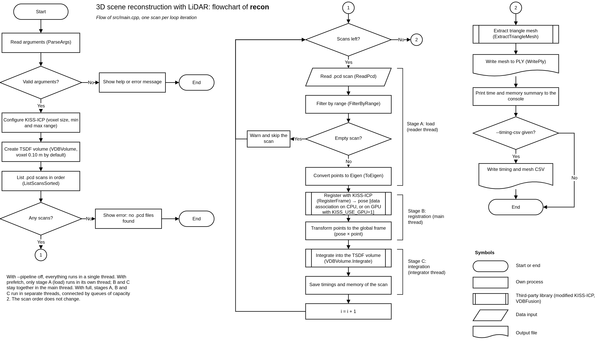
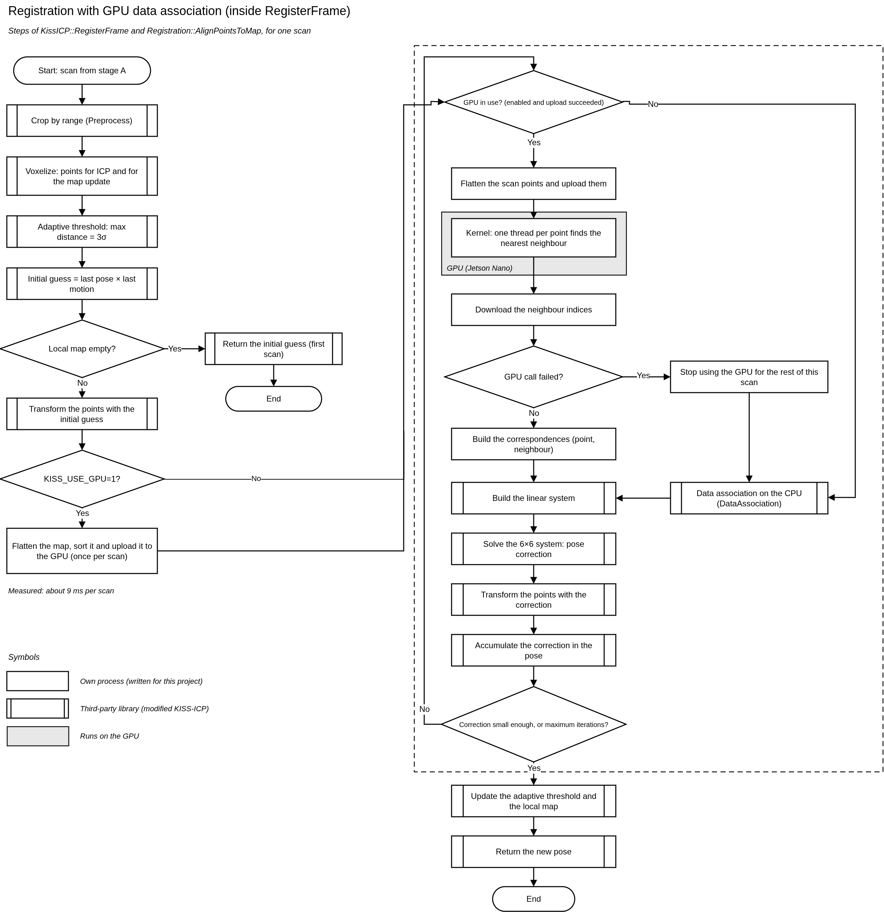

# 3D_Scene_Reconstruction_using_LiDAR

CPU prototype of a LiDAR scene reconstruction pipeline, developed for the course
EL5859 Heterogeneous Computing (Instituto Tecnológico de Costa Rica, 2026).
It turns a sequence of LiDAR scans into a 3D triangle mesh of the environment.

```
.pcd scans → range filter (NEON/scalar) → KISS-ICP (pose) → VDBFusion (TSDF) → .ply mesh
```


This repository holds the CPU baseline of the project and the first accelerator
prototype: the nearest-neighbour search of the registration (`data_association` in
KISS-ICP) runs on the GPU of an NVIDIA Jetson Nano, written in CUDA (see
[GPU accelerator](#gpu-accelerator-accelerator-i)). Later stages will optimize the
accelerator and may use a second one (FPGA, AMD Kria KV260, HLS).

## Youtube Video

This youtube video showcase a little demostration of the pipeline working a seeing the mesh at meshlab.

https://youtu.be/nKCmF2cM_jg

## What is reused and what we wrote

| Component | Origin | License |
|---|---|---|
| 3D registration (LiDAR odometry) | [KISS-ICP](https://github.com/PRBonn/kiss-icp) `v1.0.0`, copied in the `third_party/kiss_icp/` with the addon of stage timers and an optional GPU hook | MIT |
| TSDF integration and mesh extraction | [VDBFusion](https://github.com/PRBonn/vdbfusion) `v0.1.6`, used as a library | MIT |
| Pipeline (`src/main.cpp`) | Written for this project, based on VDBFusion's `examples/cpp/kitti_pipeline.cpp` | — |
| PCD reader (`src/PcdReader.cpp`) | Written for this project, following the [PCD file format specification](https://pointclouds.org/documentation/tutorials/pcd_file_format.html) | — |
| Range filter with ARM NEON (`src/RangeFilter.cpp`) | Written for this project | — |
| Scan ordering, PLY writer, timer (`src/Io.cpp`) | Written for this project | — |
| Synthetic scan generator (`tools/make_synthetic_scans.py`) | Written for this project | — |
| GPU data-association module (`gpu/`) and its bridge with KISS-ICP (`third_party/kiss_icp/core/GpuAssociation.hpp`) | Written for this project. The code was drafted with AI assistance from our specifications, then reviewed, compiled, tested and measured by us| — |


## Dependencies

Fedora:

```bash
sudo dnf install gcc-c++ cmake git eigen3-devel tbb-devel openvdb-devel \
                 imath-devel boost-devel blosc-devel python3-numpy
```

Ubuntu (including the Kria):

```bash
sudo apt install build-essential cmake git libeigen3-dev libtbb-dev \
                 libopenvdb-dev libboost-iostreams-dev libblosc-dev python3-numpy
```

OpenVDB must come from the system package manager. If CMake cannot find it, the
configuration stops with an error instead of trying to build it from source.

For the optional GPU build (Jetson Nano only) you also need CUDA 10.2 with `nvcc` and a
system GCC 8 or older as its host compiler.

## Build

```bash
cmake -B build -DCMAKE_BUILD_TYPE=Release
cmake --build build -j$(nproc)
```

KISS-ICP is already in `third_party/kiss_icp/`. The first configuration still needs
internet access to download VDBFusion and the libraries that KISS-ICP fetches (Sophus and
robin-map).
 
To offload the data association to the GPU (Jetson Nano), add `-DRECON_GPU=ON`; see
[GPU accelerator](#gpu-accelerator-accelerator-i). Without that option nothing about the GPU is compiled.

## Quick test (no dataset needed)

```bash
python3 tools/make_synthetic_scans.py --out data/synthetic --scans 20
./build/recon --scans data/synthetic --out synthetic.ply
```

Expected: the program prints the mesh size and the average time per stage, and
writes `synthetic.ply`. This only checks that everything builds and runs; the
synthetic scene is too simple to evaluate registration accuracy.

## Data

We use the [Newer College Dataset](https://ori-drs.github.io/newer-college-dataset/)
(2020, Ouster OS1-64 at 10 Hz), sequence 01 "short experiment".

### Option A: sample (300 scans, ~30 s of walking)
 
A ready-to-use sample with the matching ground-truth poses is attached to the
[v1.0.0 release](https://github.com/Geco2205/3D_Scene_Reconstruction_using_LiDAR/releases/tag/v1.0.0):
 
```bash
wget https://github.com/Geco2205/3D_Scene_Reconstruction_using_LiDAR/releases/download/v0.1.0/ncd_sample.zip
unzip ncd_sample.zip -d data
./build/recon --scans data/ncd_sample/scans --out sample.ply --icp-voxel 1.0
```

### Option B: full dataset

1. Request access through the form on the dataset website.
2. In `2020-ouster-os1-64-realsense`, open the folder of sequence 01 (short
   experiment) and download `raw_format/ouster_zip_files/` (10 zips)
   and `ground_truth/`.
3. Unzip all 10 files into the same folder. The scans are spread across the zips
   without temporal order, so all of them are needed to get a continuous sequence:
```bash
mkdir -p data/ncd
for z in ouster_scan-*.zip; do unzip -jq "$z" -d data/ncd; done
rm -f data/ncd/*"(1)".pcd    # one file is duplicated in the zips
ls data/ncd | wc -l           # expected: 15301
```
### Option C: your own scans

`recon` works with any LiDAR sequence stored as one PCD file per scan, not only with the Newer College Dataset.

| Requirement | Detail |
|---|---|
| Format | PCD with `DATA ascii` or `DATA binary`. `binary_compressed` is not supported: the reader stops with an error asking to convert the file |
| Fields | `x`, `y` and `z` as `float32` (`SIZE 4`, `TYPE F`). Any other field (intensity, ring, time, ...) is ignored, in any order |
| Invalid points | Points with `NaN` or infinite coordinates are dropped. In ASCII files, empty lines, `#` comments and truncated lines are skipped |
| Frame | One file is one scan, with the points in the sensor frame. Per-point timestamps are not used (deskewing is off) |
| File names | One directory, `.pcd` extension. Scans are sorted by the numbers in the name (first number, then the second, ...): `cloud_<sec>_<nsec>.pcd` or `000001.pcd`, `000002.pcd`, ... A name without numbers goes last, sorted alphabetically |
| Other formats | `.bin`, `.ply` or `.las` must be converted to PCD first (for example with PCL or Open3D) |

Adjust these options to the new sensor and scene:

| Option | Default | When to change it |
|---|---|---|
| `--min-range`, `--max-range` | `1.0`, `60.0` m | Match the sensor: drop returns from the sensor body or beyond its useful range |
| `--icp-voxel` | `0.50` m | KISS-ICP voxel size (the 300-scan sample uses `1.0`) |
| `--tsdf-voxel` | `0.10` m | Mesh resolution: smaller voxels give more detail and use more memory |
| `--max-scans` | `0` (all) | Process only the first N scans to test the setup quickly |
| `--timing-csv` | none | Write per-stage timings |

```bash
./build/recon --scans data/my_scene --out my_scene.ply \
    --icp-voxel 1.0 --max-range 30 --max-scans 20 --timing-csv my_scene_timings.csv
```

If something is wrong with a file, the program stops with one of these messages:

| Message | Cause |
|---|---|
| `No se encontraron archivos .pcd en <dir>` | The directory has no `.pcd` files |
| `PCD sin campos x/y/z` | The file has no fields named exactly `x`, `y` and `z` |
| `se esperaba x/y/z como float32` | The coordinates are not `float32`; convert them |
| `PCD binary_compressed no soportado` | Convert the file to `binary` or `ascii` |


## Program flow

Flow of `src/main.cpp` for one scan. Stages A, B and C are the three threads of
`--pipeline full` (see [Optimizations](#optimizations)).

[](docs/diagrams/recon_flowchart.png)


## Usage
 
```bash
./build/recon --scans <dir> [options]
```
 
| Option | Default | Description |
|---|---|---|
| `--scans <dir>` | required | Directory with the `.pcd` scans |
| `--out <file>` | `mesh.ply` | Output mesh |
| `--max-scans <n>` | `0` (all) | Number of scans to process |
| `--tsdf-voxel <m>` | `0.10` | TSDF voxel size |
| `--icp-voxel <m>` | `0.50` | KISS-ICP voxel size |
| `--min-range <m>` | `1.0` | Minimum point range |
| `--max-range <m>` | `60.0` | Maximum point range |
| `--timing-csv <file>` | — | Write per-stage timings to a CSV file |
| `--pipeline <mode>` | `off` | Task parallelism: `off`, `prefetch` or `full` (see [Optimizations](#optimizations)) |
 
Environment variables:
 
| Variable | Description |
|---|---|
| `KISS_USE_GPU=1` | Run the data association on the GPU (needs a build with `-DRECON_GPU=ON`). Without it the CPU path runs |
| `KISS_PROFILE_OUT=<file>` | Write the timers and counters of KISS-ICP to a CSV file when the program ends |
 
The timer table of KISS-ICP is printed to `stderr` at the end of every run.
 
Scans are processed in timestamp order. File names follow
`cloud_<sec>_<nsec>.pcd` and are sorted numerically, because the nanosecond
field does not always have 9 digits.

## Outputs
 
- **`<out>.ply`**: triangle mesh (ASCII PLY). Open it with MeshLab or CloudCompare.
- **`<timing-csv>`**: one row per scan. For each stage (`read`, `filter`,
  `convert`, `register`, `transform`, `integrate`) there is a wall-clock column
  `<stage>_ms` and a process CPU-time column `<stage>_cpu_ms`, plus
  `scan, points_in, points_kept` and `rss_kb` (resident memory after the scan).
- **`<mesh-csv>`**: one row per mesh extraction with
  `repeat, mesh_ms, mesh_cpu_ms, vertices, triangles`.
- **`$KISS_PROFILE_OUT`** (optional): one row per timer or counter inside KISS-ICP
  (`data_association`, `build_linear_system`, `gpu_run`, ... and `icp_iterations`,
  `correspondences`, `gpu_iterations`), with columns `tipo, nombre, eventos, total,
  media, max`.

## Viewing the mesh
 
We use [MeshLab](https://www.meshlab.net/) to inspect the reconstruction.
 
Fedora:
 
```bash
sudo dnf install meshlab
```
 
Ubuntu:
 
```bash
sudo apt install meshlab
```
 
Open the mesh:
 
```bash
meshlab sample.ply
```
 
If the 3D view is blank (common on Wayland, the default on Fedora and recent
Ubuntu), launch it with:
 
```bash
QT_QPA_PLATFORM=xcb meshlab sample.ply
```
  

### Per-stage instrumentation

The pipeline is instrumented so that each stage is measured with two clocks:
wall time (`steady_clock`) and process CPU time (`CLOCK_PROCESS_CPUTIME_ID`,
summed over all threads). Their ratio is the average number of cores the stage
used, which is what tells a stage that is slow apart from one that is already
parallel. Memory is read from `/proc/self/statm` at the end of every scan, and
the process peak from `getrusage`.

The stages are `read`, `filter`, `convert`, `register`, `transform` and
`integrate`. `transform` (mapping the points into the global frame) is measured
separately from the TSDF integration: in the original code that loop sat inside
the integration timer and inflated it.


#### Running it
 
```bash
tools/run_profile.sh --label pc1-nicole --scans data/ncd_sample/scans --icp-voxel 1.0
```
 
Plug in laptops and close other programs first, because on battery the
processor lowers its frequency and the times stop being comparable. On a
desktop CPU it takes about 3 minutes; on the Kria or the Jetson it takes longer,
mostly because of the 101 mesh repetitions.
 
It writes `results/<label>/` with `timings.csv`, `mesh.csv`, `system.txt` and
`run.log`. Mesh extraction happens once per sequence, so it is repeated on the
final volume (`--mesh-repeats`, 101 by default) to reach more than 100 samples
per stage, as the project requires. The 300-scan sample gives 300 samples for
every per-scan stage.
 
`system.txt` records the arguments, compiler, build flags, commit, CPU model
and thread count, so that a difference between machines can be explained rather
than guessed.


#### Analyzing it
 
```bash
python3 tools/analyze_profile.py results
```
 
It reads every `results/*/timings.csv` and writes to `results/analysis/`:
 
| File | Content |
|---|---|
| `summary.md` | Per machine: n, mean, std, 95 % CI, min, p50, p95, max, share of the scan time and CPU/wall ratio for each stage, plus memory and throughput. A cross-machine comparison table when there is more than one machine. |
| `summary.csv` | The same statistics in tabular form |
| `fig_breakdown.png` | Mean time per scan split by stage, one bar per machine |
| `fig_stages_box.png` | Distribution of every stage per machine (log scale) |
| `fig_timeline_<label>.png` | Time per scan and resident memory along the sequence |
 
`--skip-first N` drops the first `N` scans of every machine as warm-up (the
first registrations are cheaper because the local map is still empty).
 
The script checks that every stage has more than 100 samples and reports which
ones fall short, since with fewer samples the confidence interval of the mean
is not useful.

## Optimizations
 
The optimizations were chosen and applied following the course material,
mainly Chapter 2 (*Sistemas multiprocesador y su programación*). The chapter
gave both the method (measure the baseline, find where the time goes, optimize,
measure again) and the techniques: task parallelism with producer-consumer
queues and ping-pong buffers, compiler options (`-march=native`, LTO), and data
layout as a structure of arrays aligned to the cache line.

> **Are the optimizations incremental?** No: they are evaluated one at a time, not cumulatively. Every variant changes a single factor with respect to `base` and is compared with the same baseline, so the effect of each optimization can be isolated. The only cumulative variant is `all`, which combines them to check whether the gains add up (they do on PC1; on PC2 `all` equals `full`, and on the Kria it is lower). The GPU accelerator is a separate step measured on the Jetson Nano: the same binary runs on the CPU and, with `KISS_USE_GPU=1`, on the GPU.
 
Each optimization can be switched on or off independently, so its effect is
always measured against the same baseline. With the default build and
`--pipeline off`, the program is the baseline.
 
| Switch | Where | Default | Effect |
|---|---|---|---|
| `RECON_OPT_NATIVE` | CMake | `OFF` | `-march=native` (x86) / `-mcpu=native` (ARM), also applied to KISS-ICP and VDBFusion |
| `RECON_OPT_LTO` | CMake | `OFF` | Link-Time Optimization (`-flto`) |
| `RECON_OPT_SOA_ALIGNED` | CMake | `OFF` | Point arrays aligned to 64 bytes and branch-free compaction in the reader and the filter |
| `RECON_OPT_NEON` | CMake | `ON` | NEON intrinsics in the range filter (ARM only) |
| `--pipeline` | runtime | `off` | `prefetch` or `full` task parallelism, described below |
 
### How it is measured
 
`tools/run_optimizations.sh` builds every variant, runs each one on the 300-scan
sample through `tools/run_profile.sh` and writes the comparison table to
`results/opt-<label>/analysis/summary.md`:

```bash
tools/run_optimizations.sh --label pc-<name> --scans data/ncd_sample/scans --icp-voxel 1.0
```
 
Each variant changes one thing with respect to `base`, except `all`, which
combines everything. Laptops must stay plugged in, with no other heavy programs
open, because on battery the CPU lowers its frequency and the variants stop
being comparable. With `--pipeline` the stages overlap, so the sum of the stage
times is no longer the time per scan: throughput is computed from the measured
period between finished scans (`done_ms` column), and the speedup is taken
against `base` on the same machine.

### Where the time goes
 
In the baseline of the four machines measured so far, registration (KISS-ICP)
and TSDF integration (VDBFusion) take between 96 % and 98 % of the time per scan,
while reading, filtering and converting the points take less than 2 % (per-stage
times in [Expected results](#expected-results)):
 
| Machine | Register + integrate | Read + filter + convert |
|---|---:|---:|
| PC1 (i3-1115G4) | 97.1 % | 1.3 % |
| PC2 (i5-1135G7) | 96.3 % | 1.7 % |
| Kria KV260 (Cortex-A53) | 97.8 % | 1.4 % |
| Jetson Nano (Cortex-A57, 5 W) | 98.3 % | 1.2 % |
 
By Amdahl's law, speeding up only the reader and the filter can improve the
whole scan by less than 2 %. The optimizations that can matter are the ones
that reach the libraries or that run the two heavy stages at the same time.

### Applied
 
**Task parallelism (`--pipeline`).** Load, register and integrate are organized as a producer-consumer pipeline, each stage in its own thread, connected by bounded FIFO queues of capacity 2, following a scheme similar to the ping-pong buffers of Chapter 2. The scans are registered and integrated in the same order as in the sequential run; on PC2 the mesh was verified to have the same number of vertices and triangles as the baseline in both pipeline modes. `prefetch` only hides the load stage, which is less than 2 % of the time, and gives 1.00×. `full` also overlaps registration of scan *k+1* with integration of scan *k* and gives **1.48×** on PC2 (period 50.8 → 34.3 ms). Integration runs on a single core (CPU/wall of 1.00 on the three machines), and with `full` the period (34.27 ms) is almost equal to the integration time (34.18 ms), so integration is now the bottleneck of the pipeline.
 
**`-march=native` / `-mcpu=native`.** It lets the compiler use the CPU's extensions (AVX2/FMA, Cortex-A tuning), also in KISS-ICP and VDBFusion. It gives **1.03×** on PC2. The limited gain is consistent with OpenVDB and TBB being precompiled dependencies that these flags do not reach, although this test does not attribute the difference to that cause alone. The binary is not portable, and the mesh differs from the baseline by 3 triangles out of 1 476 686, attributable to changes in floating-point code generation; FMA was not isolated as the only cause.
 
**LTO.** It allows inlining across files and across the libraries built from source. No measurable improvement was observed (**1.00×**).
 
**Aligned SoA and branch-free compaction.** The point arrays are aligned to 64 bytes (one cache line) and written by index without branches. `read` goes from 0.54 to 0.46 ms and `filter` from 0.18 to 0.09 ms, but the overall result is **0.98×**, so no improvement of the total time was observed, as Amdahl's law predicts for stages that take less than 2 % of the time.
 
**NEON in the range filter.** It was already in the prototype; the new switch only turns it off (`noneon`) so its effect can be measured on the Kria or the Jetson.

### Not applied
 
Thread affinity was not applied because the profiling did not show evidence that thread migrations were a bottleneck, and part of the parallelism is managed internally by external libraries (TBB in KISS-ICP). NUMA-aware allocation does not apply because every target machine has a single socket.
 
`-ffast-math` and `-Ofast` were discarded because, as the course notes warn, they can change numerical results and the handling of special cases such as NaN and infinity, which the reader relies on to drop invalid points. PGO was not applied because of the extra cost of generating a representative profile and rebuilding, prioritizing more direct and reproducible optimizations for this prototype.
 
KISS-ICP and VDBFusion were not modified with manual SIMD intrinsics. The stage-level profiling did not show which internal loops would justify them, and the course material recommends trying autovectorization, checking the compiler reports and measuring before resorting to intrinsics. The finer timers added later inside KISS-ICP showed that `data_association` is the hotspot (92.6 % of the registration and 60.5 % of the scan on the Jetson Nano). Instead of vectorizing it on the CPU, it was offloaded to the GPU (see [GPU accelerator](#gpu-accelerator-accelerator-i)); manual SIMD on the CPU path of `data_association` was not tried. TSDF integration is left for the next accelerator prototypes. The SoA layout was not extended past the filter because both libraries take `Eigen::Vector3d` arrays in their API; the GPU path has to flatten the map and the scan into plain arrays, which costs about 7 ms per scan on the Jetson Nano. Mesh extraction was not parallelized because it runs once per sequence and does not affect throughput per scan.

## Expected results
 
### Without optimizations (baseline)
 
Mean time per stage, in ms per scan, over the 300-scan sample with the default
build and `--pipeline off`:
 
| Stage | PC1 (i3-1115G4) | PC2 (i5-1135G7) | Kria KV260 (Cortex-A53) | Jetson Nano (Cortex-A57) |
|---|---:|---:|---:|---:|
| read | 0.72 | 0.54 | 4.99 | 4.24 |
| filter | 0.26 | 0.18 | 2.16 | 1.95 |
| convert | 0.16 | 0.14 | 0.84 | 0.48 |
| register | 45.67 | 21.32 | 305.09 | 374.83 |
| transform | 1.34 | 0.99 | 4.35 | 2.88 |
| integrate | 38.50 | 27.57 | 249.27 | 189.90 |
| **Total per scan** | **86.65** | **50.74** | **566.71** | **574.28** |
 
Sources: `results/pc1-nicole/`, `results/opt-pc2-keilin/base/`,
`results/kria-gonzalo/` and `results/jetson-gpu/` (CPU path of the GPU build, second run).
 
### With optimizations
 
Throughput in scans/s over the 300-scan sample, with the speedup against `base`
on the same machine (from the `Ciclo de scans` line of
`results/opt-<label>/<variant>/run.log`):
 
| Variant | PC1 (i3-1115G4) | PC2 (i5-1135G7) | Kria KV260 |
|---|---:|---:|---:|
| base | 11.75 (1.00×) | 19.68 (1.00×) | 1.72 (1.00×) |
| prefetch | 11.81 (1.00×) | 19.70 (1.00×) | 1.75 (1.01×)|
| full | 14.07 (1.20×) | 29.17 (1.48×) | 2.51 (1.46×)|
| native | 12.09 (1.03×) | 20.33 (1.03×) | 1.73 (1.00×)|
| lto | 11.56 (0.98×) | 19.67 (1.00×) | 1.74 (1.01×)|
| soa | 12.12 (1.03×) | 19.37 (0.98×) | 1.75 (1.02×)|
| all | 17.93 (1.53×) | 29.06 (1.48×) | 2.16 (1.25×)|
| noneon (ARM only) | — | — | 1.73 (1.00×)|

> **Kria baseline note.** The first `base` run showed anomalous file-I/O
> behavior in the `read` stage. The variant was repeated under the same
> configuration, obtaining 1.72 scans/s. This rerun is used as the reference
> for the Kria optimization speedups reported above.
 
The earlier baseline profiling and the optimization matrix were collected in
different revisions of the prototype. Therefore, the optimization speedups
reported here are computed against the `base` variant from the same optimization
experiment.
 
On the Kria KV260, the `full` task-parallel pipeline increased throughput
from 1.72 to 2.51 scans/s (**1.46×**). The combined `all` variant reached
2.16 scans/s (**1.25×**), showing that enabling every optimization together
did not outperform the task-parallel pipeline by itself on this platform.


## GPU accelerator (Accelerator I)
 
The nearest-neighbour search of the registration (`data_association` in KISS-ICP) runs on
the GPU of an NVIDIA Jetson Nano, written in CUDA. Everything else (linear system, solver,
pose update, TSDF integration) stays on the CPU. The result is identical to the CPU
(same counters, same mesh) and the scan is **1.27×** faster.
 
### What is accelerated and why
 
On the Jetson Nano CPU, `data_association` takes **60.5 %** of the time per scan and
**92.6 %** of the registration stage. The accelerator rule of the course asks for the
offloaded functions to cover at least 50 % of the execution time; TSDF integration
(33 %) alone does not reach it.
 
| Stage (Jetson Nano, CPU, ms per scan) | Time | Share |
|---|---:|---:|
| read + filter + convert + transform | 9.6 | 1.7 % |
| register | 374.8 | 65.3 % |
| &nbsp;&nbsp;↳ of which `data_association` | 347.2 | 60.5 % |
| integrate (TSDF) | 189.9 | 33.1 % |
| **Total** | **574.3** | 100 % |
 
Each scan runs about 31 ICP iterations (9,263 in the 300-scan sample). Every iteration
looks for the nearest map point of about 1,300 scan points, and every point is
independent of the others, which is what a GPU is good at.
 
### How it works
 
For one scan point, one GPU thread:
 
1. finds the voxel it falls in (`floor(p / voxel_size)`, `floor` and not truncation so
   that negative coordinates land in the right voxel),
2. visits that voxel and its 26 neighbours,
3. locates each voxel in the voxel list with a binary search (the list is sorted
   lexicographically by `x`, then `y`, then `z`),
4. measures the distance to every point of each voxel and keeps the first minimum
   (strict `<`, as KISS-ICP does),
5. accepts it only if it is closer than `max_dist`.
The voxel map of KISS-ICP (a hash table) is flattened into four plain arrays: `coords`
(x, y, z per voxel), `start` and `count` (where the points of a voxel are in `pts`) and
`pts` (all points). The map is uploaded **once per scan** because it does not change
during the ICP loop; only the scan points and the results move on every iteration.


[](docs/diagrams/registration_gpu.png)

The shaded box is the only step that runs on the GPU; the double-bordered boxes are
KISS-ICP code. If any GPU call fails, the scan continues on the CPU path.


Files involved:
 
| Path | What it is |
|---|---|
| `gpu/voxel_search.h`, `gpu/sort_voxels.h`, `gpu/associate_one.h` | The search itself. Tagged `HD` (host + device): the same code compiles for the CPU and the GPU, so the CPU tests validate what runs on the GPU |
| `gpu/gpu_associate.h`, `gpu/gpu_associate.cu` | CUDA module with a plain C interface: `gpu_init`, `gpu_set_map`, `gpu_run`, `gpu_free`, `gpu_get_timing` |
| `third_party/kiss_icp/` | KISS-ICP `v1.0.0` with our changes. Only 4 files differ from upstream: see `docs/kiss-icp-changes.diff` |
| `third_party/kiss_icp/core/GpuAssociation.hpp` | Bridge: flattens the map and the scan, calls the module and builds the correspondences |
| `cmake/ReconGpu.cmake` | `RECON_GPU` option: builds `gpu/` with `nvcc` and links it |
 
Main design decisions: `double` precision so the result matches the CPU exactly (`float`
and FP16 are left for the next stage); strict `<` and `sqrt` distances with the same
summation order as Eigen, so ties are broken like on the CPU; `--fmad=false` so `nvcc`
does not fuse multiply-adds; explicit `cudaMalloc`/`cudaMemcpy`, so every transfer can be
measured; buffers reserved once in `gpu_init`; the map is sorted inside `gpu_set_map`, so
nobody can forget to sort it; and if any GPU call fails the error is printed, counted in
`gpu_fallbacks`, and that scan finishes on the CPU with the correct result.

### Build and run (Jetson Nano)
 
Requirements: CUDA 10.2 (`/usr/local/cuda/bin/nvcc`) and a system GCC 8 or older as the
`nvcc` host compiler (GCC 7.5 on Ubuntu 18.04). No `sudo` is needed.
 
```bash
cmake -B build-gpu -DCMAKE_BUILD_TYPE=Release -DRECON_GPU=ON
nohup nice -n 19 cmake --build build-gpu -j1 > build-gpu.log 2>&1 < /dev/null &
```
 
`-j1` because the Jetson Nano has 2 GB of RAM. Extra CMake options: `RECON_NVCC`
(default `/usr/local/cuda/bin/nvcc`), `RECON_CUDA_ARCH` (`sm_53`),
`RECON_CUDA_HOST_COMPILER` (`/usr/bin/g++`) and `RECON_CUDA_LIBDIR`
(`/usr/local/cuda/lib64`). On the shared course board the project is built with the
conda GCC 12 toolchain; pass the same compiler and prefix flags as for the CPU build
and add `-DRECON_GPU=ON`.
 
The same binary runs on the CPU or on the GPU:
 
```bash
# CPU
KISS_PROFILE_OUT=cpu.csv ./build-gpu/recon --scans data/ncd_sample/scans --icp-voxel 1.0 --out cpu.ply
# GPU
KISS_USE_GPU=1 KISS_PROFILE_OUT=gpu.csv ./build-gpu/recon --scans data/ncd_sample/scans --icp-voxel 1.0 --out gpu.ply
```

Expected lines in `gpu.csv` for the 300-scan sample (the first two must be identical to
the CPU run, `gpu_iterations` must equal `icp_iterations`, and `gpu_fallbacks` must not
appear):
 
```
contador,gpu_iterations,9263,9263,1.000,1
contador,icp_iterations,9263,9263,1.000,1
contador,correspondences,9263,11864440,1280.842,2096
```
 
The two `.ply` files must be identical (`md5sum cpu.ply gpu.ply`). The columns of the CSV
are `tipo, nombre, eventos, total, media, max` (kind, name, events, total, mean, max).
 
For the per-scan profile with the GPU enabled:
 
```bash
KISS_USE_GPU=1 tools/run_profile.sh --label jetson-gpu --scans data/ncd_sample/scans \
    --icp-voxel 1.0 --bin build-gpu/recon
```

### Results
 
Measured on the Jetson Nano 2 GB (2 Cortex-A57 cores, 5 W power mode, GPU limited to
614.4 MHz), 300 scans, `--icp-voxel 1.0`, `--pipeline off`. Four runs in alternating order
(CPU, GPU, CPU, GPU) on the shared board. The CPU reference is the second CPU run: in the
first one the `read` stage was slow because the files were not in the disk cache yet.
 
**Same result as the CPU**
 
| Check | CPU (2 runs) | GPU (2 runs) |
|---|---|---|
| ICP iterations | 9,263 | 9,263 |
| Correspondences | 11,864,440 | 11,864,440 |
| Iterations served by the GPU | — | 9,263 (all) |
| `gpu_fallbacks`, `gpu:` messages, `CUDA error` | — | none |
| Final mesh hash (first 12 hex digits) | `1ebf710cb8e2` | `1ebf710cb8e2` |
 
**Time per scan (ms, 300 samples per stage)**
 
| Stage | CPU | GPU | Speedup |
|---|---:|---:|---:|
| read | 4.2 | 4.5 | |
| filter | 1.9 | 1.9 | |
| convert | 0.5 | 0.5 | |
| **register** | **374.8** | **251.8** | **1.49×** |
| transform | 2.9 | 3.2 | |
| integrate (TSDF) | 189.9 | 191.5 | no change |
| **Total per scan** | **574.3** | **453.3** | **1.27×** |
| Scans per second | 1.74 | 2.20 | |
| `data_association` (GPU: includes flattening and uploading the map) | 347.2 | 208.1 | **1.67×** |
 
**Statistics (ms per scan; GPU is the mean of its two runs)**
 
| Stage | CPU mean | CPU std | CPU p50 | CPU p95 | GPU mean | GPU std | GPU p50 | GPU p95 |
|---|---:|---:|---:|---:|---:|---:|---:|---:|
| register | 374.8 | 211.9 | 374.9 | 743.5 | 251.8 | 131.9 | 245.9 | 485.7 |
| integrate | 189.9 | 16.2 | 184.2 | 211.2 | 191.4 | 15.7 | 186.1 | 211.7 |
| **Total per scan** | 574.3 | 222.4 | 565.9 | 950.6 | 453.3 | 142.7 | 449.2 | 695.4 |
 
The speedup is 1.26× on the median of the total and 1.37× on the 95th percentile: the GPU
helps most in the heaviest scans.
 
**Where the GPU cost goes (ms per scan)**
 
| Part | ms | Share |
|---|---:|---:|
| `gpu_run` (copies + kernel) | 195.5 | 93.9 % |
| `gpu_set_map` (sort + upload the map) | 5.7 | 2.7 % |
| `gpu_flatten_map` | 3.5 | 1.7 % |
| `gpu_build_pairs` | 3.1 | 1.5 % |
| `gpu_flatten_source` | 0.4 | 0.2 % |
| **Total** | **208.1** | 100 % |
 
In an isolated benchmark, the kernel was about 78 % of `gpu_run` and the two copies about
17 %. The glue code with KISS-ICP costs about 7 ms per scan (3.3 %).
 
Sources: `results/jetson-gpu/` (`full_cpu_*.csv`, `full_gpu_*.csv` and the matching
`.out` files).

### Observations and limits
 
- **The speedup is bounded.** Even with a free `data_association`, the scan would be at
  most 2.54× faster. With the GPU, TSDF integration (191 ms, 42 % of the scan) is as large
  as the registration.
- **CPU work that was not offloaded became slower** in the GPU runs: `build_linear_system`
  goes from 9.7 to 21.9 ms, `transform_points` goes from 1.55 to 2.63 ms and `update_local_map` goes from 2.48 to 4.24 ms
  per scan (+15.6 ms in total, consistent across both runs). The cause was not measured;
  it may be that the two CPU cores idling while the iteration waits for the GPU and the
  correspondences now being built by a single thread.
- **The GPU clock is limited to 614.4 MHz** (`max_freq`, 5 W mode; the hardware allows up
  to 921.6 MHz). It also ramps up in steps when it receives load (about 2 s from 76.8 to
  614.4 MHz), so isolated measurements need a warm-up of a few seconds.
- One dataset, one board, two runs per mode, and a shared board with other users.
  `--pipeline off` was used in all GPU measurements; `prefetch` and `full` were not
  measured with the GPU.
- This is the baseline accelerator, no optimizations were applied.

### Parameters and constants
 
| Parameter | Value | Where |
|---|---|---|
| Threads per block | 128 | `gpu/gpu_associate.cu` |
| GPU capacity: voxels / map points / scan points | 65,536 / 1,048,576 / 16,384 (about 27 MB) | `third_party/kiss_icp/core/GpuAssociation.hpp` |
| KISS-ICP voxel size | 1.0 m | `--icp-voxel 1.0` |
| TSDF voxel size | 0.10 m | `--tsdf-voxel` (default) |
| Range filter | [1, 60] m | `--min-range`, `--max-range` |
| Points per voxel (maximum) | 20 | KISS-ICP configuration |
| CUDA architecture | `sm_53` | `RECON_CUDA_ARCH` |
| `nvcc` flags | `-std=c++14 --fmad=false -O2` | `cmake/ReconGpu.cmake` |
| Return codes | `-1` map does not fit, `-2` too many scan points, `-3` CUDA failure, `-4` no map loaded | `gpu/gpu_associate.h` |

## Next steps
 
The nearest-neighbour search of the registration now runs on the GPU. With it, TSDF
integration is the largest remaining stage (42 % of the scan time on the Jetson Nano).
The next steps, all still to be measured, are:
 
- **Optimize the accelerator.** `gpu_run` is 94 % of the GPU cost.
- **Measure `--pipeline full` together with the GPU**, since registration and integration
  can overlap.
- **Move more work to an accelerator**: the TSDF integration (it runs on one core), or an
  HLS pipeline for the nearest-neighbour search on the Kria KV260.


## Usage of AI

Note on the use of AI tools

AI tools are used as support to understand concepts, generate ideas, and improve the writing of the documentation. Implementation, validation, and results are the student's responsibility, who assumes responsibility for any use beyond, or not described in, the above.

The shared conversation links are attached as evidence.

Gerson: https://claude.ai/share/be045057-e15d-462e-9e98-40855a3e21fa

Nicole: https://chatgpt.com/share/6ab9b72b-0e5c-83e8-983b-1d71080f1d52

Keilin: https://chatgpt.com/share/6abbee3d-ba9c-83e8-bdcb-177f0710a5cb

Gonzalo: https://chatgpt.com/share/6abc539e-4118-83e8-bd86-a0ebd38bcdda

GPU Accelerator: https://claude.ai/share/be045057-e15d-462e-9e98-40855a3e21fa
This chat was used by everyone to work on the codes.


## References

- I. Vizzo, T. Guadagnino, B. Mersch, L. Wiesmann, J. Behley, and C. Stachniss,
  "KISS-ICP: In Defense of Point-to-Point ICP – Simple, Accurate, and Robust
  Registration If Done the Right Way," *IEEE Robotics and Automation Letters*,
  vol. 8, no. 2, pp. 1029–1036, 2023.
- I. Vizzo, T. Guadagnino, J. Behley, and C. Stachniss, "VDBFusion: Flexible and
  Efficient TSDF Integration of Range Sensor Data," *Sensors*, vol. 22, no. 3,
  p. 1296, 2022.
- M. Ramezani, Y. Wang, M. Camurri, D. Wisth, M. Mattamala, and M. Fallon,
  "The Newer College Dataset: Handheld LiDAR, Inertial and Vision with Ground
  Truth," in *Proc. IEEE/RSJ IROS*, 2020. Licensed under CC BY-NC-SA 4.0.

## Authors

Gonzalo Alpízar Salas, Gerson Adrián Cordero Zúñiga, Nicole Irina Corrales
Rodríguez, Keilin Loáisiga Téllez — Escuela de Ingeniería Electrónica, ITCR.
